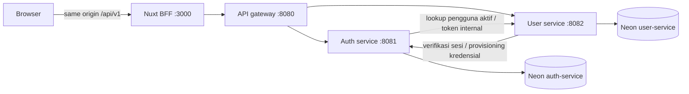

# Arsitektur layanan dan kontrak API

Tambahan capstone service (:8083), schema `capstone_service`, driver R2, Redis gateway, lima peran, dan API akademik dijelaskan pada [capstone-workflow.md](capstone-workflow.md). Uraian di bawah adalah fondasi tahap awal; limiter gateway memakai Redis ketika dikonfigurasi.



Auth dan user bisa mulai tanpa saling menunggu: health mereka memeriksa database masing-masing. Interaksi dua arah di atas tidak rekursif. Endpoint lookup internal user hanya membaca profil; endpoint verifikasi sesi internal auth hanya membaca sesi. Tidak memanggil middleware publik layanan lainnya.

## Kepemilikan data

| Repository | Database / schema | Data yang dimiliki |
| --- | --- | --- |
| auth-service | auth-service / auth_service | credentials, sessions, schema_migrations |
| user-service | user-service / user_service | users, audit_logs, schema_migrations |
| api-gateway | tidak ada | routing, origin policy, rate limit sementara per instance |
| frontend | tidak ada | tampilan dan state UI; cookie sesi tidak dibaca JavaScript |

Role PostgreSQL runtime berbeda (`capstone_auth_app`, `capstone_user_app`) dan memiliki schema layanan masing-masing. PUBLIC tidak memiliki akses schema layanan. Skrip administratif menggunakan kredensial owner hanya ketika bootstrap. Tidak ada user foreign key di auth database yang menunjuk database user; UUID adalah kontrak lintas layanan.

`capstone.sql` sumber menggunakan schema monolit `capstone`, dengan password di users, tabel user_roles, students, lecturers, dan auth_identities. Implementasi ini memindahkan password ke auth credentials, menyatukan subset profil akademik/peran yang diperlukan tahap ini dalam user users, serta menambah sessions dan audit lokal. Ini adaptasi skema untuk batas layanan; bukan menjalankan keseluruhan SQL monolit atau migrasi data lama. Jika nanti ada data lama, diperlukan migrasi data khusus yang menjaga UUID dan memverifikasi relasi.

`study_program` saat ini tetap `Teknologi Informasi`, sesuai studi kasus satu prodi. Master akademik dinamis ditunda ke academic-service; belum ada referensi lintas layanan ke study_programs. KOPRODI adalah peran tambahan DOSEN. Jabatan koordinator capstone, pembimbing, dan penguji tidak diasumsikan sama dengan Koprodi.

## Autentikasi dan otorisasi

1. Browser POST email/kata sandi ke Nuxt, Nuxt meneruskan ke gateway, lalu auth.
2. Auth meminta profil aktif melalui lookup internal user-service dan memeriksa bcrypt cost 12. Pesan salah tidak membedakan email tidak ditemukan, password salah, atau akun nonaktif.
3. Auth membuat token acak 32 byte, menyimpan SHA-256(token), dan mengirim cookie `capstone_session` HttpOnly + SameSite Strict + Path `/`. Masa berlaku absolut 8 jam. `Secure` aktif pada deployment HTTPS.
4. User-service memverifikasi cookie lewat endpoint privat auth, kemudian membaca status/peran terkini pada database sendiri. Browser tidak bisa mengirim peran untuk menjadi ADMIN.
5. Logout menghapus sesi di server dan cookie. Ganti/reset kata sandi menghapus semua sesi pengguna. Nonaktifkan akun juga mencabut semua sesi; setiap akses tetap memeriksa status aktif.

Tidak ada JWT/refresh token, OAuth, email verification, signup mandiri, atau MFA pada tahap ini. Sesi server dipilih agar logout dan pencabutan dapat segera diverifikasi tanpa denylist JWT. Token internal adalah shared secret arah layanan yang berbeda, dibandingkan secara constant time. Deployment lintas mesin harus mengenkripsi jaringan internal atau memakai mTLS/service mesh; Compose lokal memakai jaringan privat.

Gateway menolak origin selain yang dikonfigurasi, request cross-site, dan mutasi tanpa JSON Content-Type. Nuxt juga memeriksa origin sebelum meneruskan. SameSite Strict + pemeriksaan Origin + JSON Content-Type memberikan perlindungan CSRF untuk browser pada setup satu origin ini. Klien CLI tanpa Origin tetap dapat memakai API dengan cookie yang sah.

## Endpoint browser / gateway

Semua body JSON, kecuali respons 204. Kegagalan: `{"error":{"message":"Pesan yang dapat ditampilkan"}}`. Tidak ada stack trace atau detail SQL dalam respons layanan.

| Metode / path | Akses | Hasil |
| --- | --- | --- |
| POST /api/v1/auth/login | umum | 200 `{user, expires_at}`, Set-Cookie |
| POST /api/v1/auth/logout | cookie opsional | 204; idempoten |
| PUT /api/v1/auth/password | pengguna aktif | 204; current_password, new_password; seluruh sesi dicabut |
| GET /api/v1/me | pengguna aktif | 200 `{user}` lengkap |
| PUT /api/v1/me | pengguna aktif | 200 `{user}`; nama/email, telepon mahasiswa/dosen, keahlian dosen |
| GET /api/v1/users | ADMIN | 200 `{items,total,page,limit}` |
| POST /api/v1/users | ADMIN | 201 `{user}`; mahasiswa atau dosen, password awal |
| GET /api/v1/users/:id | ADMIN | 200 `{user}` |
| PUT /api/v1/users/:id | ADMIN | 200 `{user}`; penyuntingan profil/peran mahasiswa/dosen |
| PATCH /api/v1/users/:id/status | ADMIN | 204; `{is_active: boolean}` |
| PUT /api/v1/users/:id/password | ADMIN | 204; `{password}`; seluruh sesi target dicabut |
| GET /api/v1/users/stats | ADMIN | 200 `{total,active,students,lecturers}` |
| GET /api/v1/users/audit | ADMIN | 200 `{items}` 20 perubahan terbaru |

Daftar pengguna: parameter `q` (nama/email/NIM), `role` (ADMIN/MAHASISWA/DOSEN/KOPRODI), `status` (active/inactive), dan `page` (mulai 1). Ukuran halaman tetap 12. Nilai filter tak dikenal ditolak. `q` mendukung wildcard PostgreSQL ILIKE; seluruh query tetap parameterized.

Contoh body membuat mahasiswa:

```json
{
  "full_name": "Nama mahasiswa",
  "email": "mahasiswa@example.com",
  "roles": ["MAHASISWA"],
  "nim": "2305551001",
  "admission_year": 2023,
  "phone": "",
  "password": "kata-sandi-awal-unik",
  "is_active": true
}
```

Contoh dosen: roles `["DOSEN"]` atau `["DOSEN","KOPRODI"]`; nip/nidn opsional; keahlian dan telepon opsional. Nama 2–150 karakter, email maksimal 254 karakter dan unik tanpa membedakan huruf besar, NIM/NIP/NIDN maksimal 30 karakter dan unik jika diisi. Password baru 12–72 byte, bukan jumlah karakter Unicode. Akun ADMIN dilindungi dari penyuntingan peran/status pada modul ini.

Status HTTP utama: 401 sesi/kredensial tidak valid; 403 peran/origin tidak diizinkan; 409 identitas duplikat; 422 validasi gagal; 429 batas request; 503 dependency tidak tersedia. Kegagalan database tak terduga mendapat 500 generik.

## API internal

Auth, header `X-Service-Token: AUTH_INTERNAL_TOKEN`:

- POST `/internal/sessions/verify`, body `{token}`, hasil `{user_id}`.
- PUT `/internal/credentials/:id`, body `{password}`, hasil 201.
- DELETE `/internal/credentials/:id`, hasil 204; menghapus sesi terkait melalui cascade.
- PUT `/internal/credentials/:id/password`, body `{password}`, hasil 204.
- DELETE `/internal/sessions/user/:id`, hasil 204.

User, header `X-Service-Token: USER_INTERNAL_TOKEN`:

- GET `/internal/users/by-email?email=...`, hasil profil pengguna.
- GET `/internal/users/:id`, hasil profil pengguna.
- POST `/internal/users/:id/login`, pembaruan waktu login terakhir, hasil 204.
- POST `/internal/bootstrap`, membuat satu admin awal hanya jika belum ada admin; hasil 201 atau 409. Dilindungi advisory lock untuk bootstrap serentak.

Gateway tidak meneruskan path privat atau header service-token yang dikirim klien. Port service hanya loopback pada dev dan tidak diterbitkan pada Compose.

## Konsistensi dan batas operasional

Create user: transaksi lokal profil+audit → panggil auth membuat kredensial → commit profil. UI baru mendapat 201 setelah commit. Kegagalan auth membatalkan transaksi lokal dan mencoba mengompensasi kredensial. Kredensial yatim karena timeout/kompensasi gagal tidak dapat digunakan login karena tidak memiliki profil. Commit ambigu menghasilkan 503 yang meminta admin memeriksa daftar sebelum mencoba kembali.

Ini tidak memberikan transaksi ACID lintas database atau jaminan exactly-once. Sebelum deployment yang memerlukan pemulihan otomatis, tambahkan durable provisioning saga/outbox serta idempotency key. Sampai itu tersedia, operator dapat merekonsiliasi UUID auth credentials yang tidak mempunyai profil melalui API internal user, setelah memeriksa transaksi aktif; jangan menghapus berdasarkan satu kegagalan jaringan. Tidak ada proses auto-cleanup yatim yang berisiko menghapus pengguna yang sedang diprovisi.

Reset kata sandi dan audit juga melintasi layanan: jika kredensial berhasil berubah tetapi audit gagal, respons menyatakan perubahan kata sandi telah terjadi. Waktu login terakhir diperbarui best effort; kegagalan pembaruan tidak membatalkan login yang sah. Error ini tidak boleh diartikan sebagai jaminan audit login lengkap.

Rate limit in-memory per instance; horizontal scaling memerlukan shared store. Tidak ada Redis/broker/Kubernetes yang dibangun karena belum diperlukan untuk batas fitur ini. Pool PostgreSQL maksimal 5 koneksi per service, dependency HTTP memiliki timeout, request database diberi deadline, dan shutdown menunggu sampai 10 detik. Sesi kedaluwarsa ditolak tetapi belum memiliki scheduler pembersihan otomatis.
